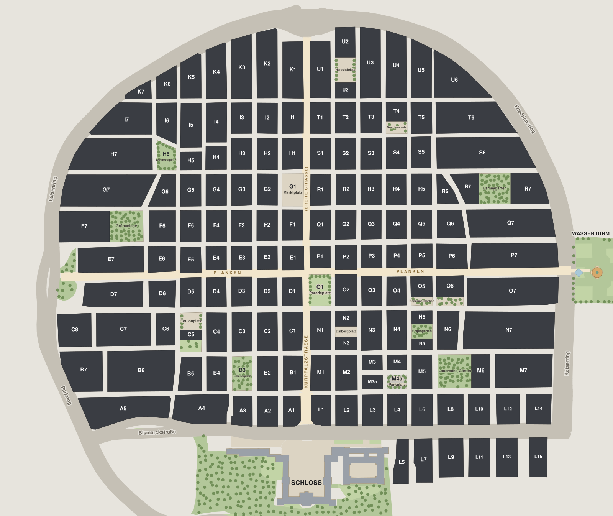

# Zwischenversion V1: nur HTML und CSS

Stand: 2026-10-07. Gilt für diesen Ordner `versionen/v1-html-css/`.

Diese Version zeigt, was wir mit dem Stoff der **Vorlesungen 1 bis 5** (HTML und CSS) bauen können. Sie ist eine Kopie von `pivot/`, die umgebaut wurde: kein JavaScript, kein PHP, keine 3D-Karte, keine Animationen und Übergänge. Das CSS ist neu geschrieben und nutzt nur, was auf den Folien steht (Ausnahmen unten).

## Öffnen

`index.html` doppelklicken. Es braucht keinen Server und keine Internetverbindung (nur die OpenStreetMap-Karte auf „Ort vorschlagen“ lädt aus dem Internet).

## Was die Version kann

| Seite | Inhalt |
|---|---|
| `index.html` | Lageplan der Innenstadt (2D, von oben). Jedes der 146 Quadrate ist ein Link. Maus darüber: gelbe Fläche. Klick: Sprung zur Zeile im Verzeichnis. `index.html#G1` markiert G1 auf der Karte. |
| `quadrate.html` | Tabelle aller 146 Quadrate: Art und Lage, Zahl der Orte je Kategorie (Essen, Trinken, Kultur, Shoppen), Kurzinfo mit Quelle, Link zurück zur Karte. Sprungliste A bis U. Die angesprungene Zeile ist gelb. |
| `vorschlagen.html` | Kontaktformular (prüft der Browser selbst, sendet noch nichts) und OpenStreetMap-Karte im iframe. |
| `ueber-uns.html` | Idee, So funktioniert es, Team, Logo, Video (als „geplant“), Technik je Vorlesung. |
| `impressum.html`, `datenschutz.html` | Pflichtseiten, als kurzes Muster. |

## Was gegenüber `pivot/` fehlt (kommt mit V2 und V3)

- Filter nach Wochentag, Uhrzeit und Kategorie, gefärbte Karte, Legende, Steckbrief unter der Karte, Suchen und Sortieren im Verzeichnis, Meldungen im Formular (JavaScript, Vorlesung 6).
- 3D-Karte mit wachsenden Gebäuden (JavaScript und CSS-Transformationen).
- Anmelden, „Meine Orte“, Formularversand (PHP, Vorlesung 7).
- Video: in dieser Version nur als „geplant“ angekündigt (Entscheidung des Teams). Das Pflicht-Element „eigenes Video im mp4-Format“ (Team-Übung 2) ist damit hier noch offen.

## Wie die Karte ohne JavaScript klickbar ist

```html
<div class="map-scroll">                      <!-- scrollt auf dem Handy seitlich: overflow-x: auto -->
  <div class="map-box">                       <!-- position: relative = Bezugspunkt -->
          <!-- das Bild gibt dem Kasten seine Höhe -->
    <a class="block" id="G1" href="quadrate.html#q-G1" title="G1 – Marktplatz"
       style="left: 46.07%; top: 33.68%; width: 3.38%; height: 6.14%;">G1</a>
    …                                         <!-- 146 Links -->
```

- Jeder Link hat `position: absolute` und liegt dadurch über dem Bild. `left`, `top`, `width`, `height` in Prozent: Die Flächen wachsen und schrumpfen mit dem Bild.
- Der Linktext (`G1`) ist durchsichtig (`color: transparent`), weil das Bild das Kürzel schon zeigt. Bildschirmleser lesen ihn trotzdem.
- `:hover` und `:focus` färben die Fläche halbdurchsichtig gelb (`rgba`). `:target` markiert das Quadrat, dessen `id` hinter dem `#` in der Adresse steht.
- Die 146 Links (in `index.html`) und die 146 Tabellenzeilen (in `quadrate.html`) stehen zwischen den Kommentaren `BEGIN generated` und `END generated`. Sie wurden mit einem Python-Werkzeug aus den OpenStreetMap-Daten erzeugt (`tools/export_v1.py`, liegt im Entwicklungsordner von Anes, nicht in diesem Repo). Wer eine Zeile von Hand ändert: Beim nächsten Erzeugen wird sie überschrieben.

## Begriffe je Seite (zum Erklären in der Präsentation)

Folien: „VL5 S.16“ = Vorlesung 5, Folie 16. Zeilen: Stand 2026-10-07; nach Änderungen nach dem Code suchen.

### Alle Seiten

| Begriff | Fundstelle | Folie |
|---|---|---|
| Grundgerüst: `<!DOCTYPE html>`, `<meta charset="utf-8">`, `<title>` | `index.html:1`, `index.html:22` | VL2 S.3 |
| Externes Stylesheet `<link rel="stylesheet">` | `index.html:27` | VL2 S.3, VL4 S.11 |
| `@charset "utf-8";` am Anfang der CSS-Datei | `css/style.css:1` | VL4 S.11 |
| Eigene Schriften mit `@font-face` (keine Google-Verbindung, DSGVO) | `css/style.css:30` | VL4 S.25, VL5 S.3 |
| `rem` und `font-size: 100%` | `css/style.css:72` | VL4 S.17–S.19 |
| Mehrere Selektoren `h1, h2, h3` | `css/style.css:85` | VL4 S.20 |
| Link-Zustände `a:link`, `a:visited`, `a:focus`, `a:hover`, `a:active` | `css/style.css:136` bis `154` | VL4 S.24, VL5 S.9 |
| Sprunglink, versteckt mit `position: absolute` und `top: -4rem` | `index.html:31`, `css/style.css:165` | VL5 S.16 |
| Zentrierte Spalte mit `max-width` und `margin: 0 auto` | `css/style.css:184` | VL5 S.15 |
| Navigation als Liste, `display: inline-block` | `index.html:36`, `css/style.css:217` | VL2 S.6, VL5 S.17 |
| Klasse `current` für die aktuelle Seite | `index.html:38`, `css/style.css:240` | VL5 S.4 |
| Spezifität: `main.container` gewinnt gegen `.container` | `css/style.css:245` | VL5 S.6 |
| Knopf als „Gebäude“: `border-bottom` als Wandkante | `css/style.css:341` | VL5 S.12 |
| Media Query für das Handy | `css/style.css:451` | VL5 S.3 |
| Fußzeile mit Impressum und Datenschutz | `index.html:218` | VL2 S.8 |

### Startseite `index.html` und `css/index.css`

| Begriff | Fundstelle | Folie |
|---|---|---|
| Bild mit `width`, `height`, `alt`, `title` | `index.html:60` | VL2 S.7 |
| `overflow-x: auto` (seitlich scrollen) | `css/index.css:19` | VL5 S.14 |
| `position: relative` (Bezugspunkt) | `css/index.css:27` | VL5 S.16 |
| `position: absolute` (Klickflächen) | `css/index.css:44` | VL5 S.16 |
| Inline-`style` mit Prozentwerten | `index.html:103` (G1) | VL3 S.3, VL4 S.9 |
| Anker auf eine andere Seite `quadrate.html#q-G1` | `index.html:103` | VL3 S.2 |
| `color: transparent` | `css/index.css:47` | VL4 S.13 |
| `:hover`, `:focus` mit `rgba` | `css/index.css:55`, `57` | VL4 S.14, S.24 |
| `:target` (nicht auf den Folien, siehe Ausnahmen) | `css/index.css:64` | Prinzip VL4 S.24 |
| Hinweis nur auf dem Handy: `display: none` und Media Query | `css/index.css:89` | VL5 S.3, S.17 |

### Verzeichnis `quadrate.html` und `css/verzeichnis.css`

| Begriff | Fundstelle | Folie |
|---|---|---|
| Sprungliste mit Ankern auf derselben Seite | `quadrate.html:55` | VL2 S.6 |
| `<strong>`, `<em>` | `quadrate.html:50`, `51` | VL2 S.5, S.6 |
| Tabelle `table`, `caption`, `thead`, `th`, `tr`, `td` | `quadrate.html:87` bis `91` | VL3 S.2 |
| Zeile mit `id` als Sprungziel | `quadrate.html:555` (G1) | VL3 S.2 |
| Link zurück `index.html#G1` | `quadrate.html:564` | VL3 S.2 |
| `border-collapse` (Tabelle mit CSS) | `css/verzeichnis.css:48` | VL3 S.2 |
| Farbige Kategorie-Linie mit `border-bottom` | `css/verzeichnis.css:74` | VL5 S.12 |
| `tr:hover` mit `rgba` | `css/verzeichnis.css:80` | VL4 S.14, S.24 |
| `min-width` für die Kurzinfo | `css/verzeichnis.css:106` | VL5 S.15 |
| `tr:target` (angesprungene Zeile) | `css/verzeichnis.css:111` | Prinzip VL4 S.24 |

### Ort vorschlagen `vorschlagen.html` und `css/formular.css`

| Begriff | Fundstelle | Folie |
|---|---|---|
| `form` mit `action="#"` (sendet noch nichts) | `vorschlagen.html:53` | VL3 S.2 |
| `fieldset` und `legend` | `vorschlagen.html:54`, `55` | VL3 S.2 |
| `label for` + `input`, `required`, `minlength`, `maxlength` | `vorschlagen.html:57` | VL3 S.2 |
| `type="email"` | `vorschlagen.html:62` | VL3 S.2 |
| Auswahlliste `select`, `optgroup`, `option` | `vorschlagen.html:73` | VL3 S.2 |
| Radiobuttons (eine Gruppe über gleichen `name`) | `vorschlagen.html:231` | VL3 S.2 |
| `textarea` | `vorschlagen.html:240` | VL3 S.2 |
| Knöpfe `submit` und `reset` | `vorschlagen.html:244`, `245` | VL3 S.2 |
| `iframe` (fremde Inhalte) | `vorschlagen.html:253` | VL3 S.2 |
| Zielfenster `target="_blank"` | `vorschlagen.html:256` | VL2 S.6 |
| Inline-Verfahren `style` | `vorschlagen.html:260` | VL3 S.3, VL4 S.11 |
| Zwei Spalten mit `float: left` / `float: right`, Ende mit `clear: both` | `css/formular.css:11`, `16`, `20` | VL5 S.14 |
| `display: block` für Beschriftungen | `css/formular.css:55` | VL5 S.17 |

### Über uns `ueber-uns.html` und `css/info.css`

| Begriff | Fundstelle | Folie |
|---|---|---|
| Anker-Links zu den Abschnitten | `ueber-uns.html:48` | VL2 S.6 |
| Textumfluss: Lageplan mit `float: right`, danach `clear: both` | `ueber-uns.html:64`, `css/info.css:50`, `44` | VL5 S.14 |
| `<u>`, `<b>`, `<i>` | `ueber-uns.html:69` | VL2 S.6, S.9 |
| Fotos mit `alt` und `title`, gleich hoch durch `overflow: hidden` | `ueber-uns.html:77`, `css/info.css:76` | VL2 S.7, VL5 S.14 |
| Nummerierte Liste `ol` | `ueber-uns.html:97` | VL2 S.6 |
| Teamkarten nebeneinander mit `display: inline-block` | `ueber-uns.html:113`, `css/info.css:28` | VL5 S.17 |
| Zeilenumbruch `<br>` | `ueber-uns.html:114` | VL2 S.6 |
| Logo | `ueber-uns.html:125` | VL3 S.4 |
| Definitionsliste `dl`, `dt`, `dd` | `ueber-uns.html:127` | VL2 S.6 |
| Trennlinie `<hr>` | `ueber-uns.html:145` | VL2 S.6 |

### Impressum und Datenschutz

| Begriff | Fundstelle | Folie |
|---|---|---|
| Pflichtseiten Impressum und Datenschutz | `impressum.html`, `datenschutz.html` | VL2 S.8 |
| `<address>` mit `<br>` | `impressum.html:47` | VL2 S.6 |
| `mailto:`-Link | `impressum.html:56` | VL2 S.6 |
| Links auf Dateien (Lizenztexte) | `impressum.html:110` | VL2 S.6 |
| Inhaltsverzeichnis als `ol` mit Ankern | `datenschutz.html:49` | VL2 S.6 |

## Nicht auf den Folien (bewusst, kurz erklärbar)

| Technik | Wo | Warum |
|---|---|---|
| Flexbox `display: flex` | Kopfzeile (`css/style.css:196`) | Logo links, Navigation rechts. In VL3 S.3 als „modernes Layout-Modell“ erwähnt. |
| `box-sizing: border-box` | `css/style.css:68` | Breite und Höhe enthalten Innenabstand und Rahmen. Sonst ragt ein Eingabefeld mit `width: 100%` plus `padding` aus seinem Kasten. |
| Pseudoklasse `:target` | Karte und Tabelle | Wie `:hover`, aber für das Element, dessen `id` in der Adresse hinter `#` steht. |
| `aria-label`, `aria-current` | Navigation | Nur für Bildschirmleser, ändern nichts am Aussehen. |

## Pflicht-Elemente aus den Team-Übungen (VL2 S.9, VL3 S.4)

| Element | Wo |
|---|---|
| Mehrere verlinkte Unterseiten mit Navigation | 6 Seiten, Navigation in jedem Kopf |
| Startseite, Unterseiten, Impressum, Datenschutz | alle Seiten |
| Überschriften, Absätze, Listen | alle Seiten |
| fett, kursiv, unterstrichen, Zeilenumbruch, Trennlinie | `ueber-uns.html:69`, `:114`, `:145` |
| Bilder mit Breite, Höhe, Alt-Text, Titel | `index.html:60`, `ueber-uns.html:77` |
| Farben, Größen, Schriftfamilien | `css/style.css` |
| Logo | jede Seite oben links, `ueber-uns.html:125` |
| Anker auf eine Stelle einer anderen Seite | `index.html:103`, `quadrate.html:564` |
| Tabelle | `quadrate.html:87`, `ueber-uns.html:153` |
| Formular | `vorschlagen.html:53` |
| iframe | `vorschlagen.html:253` |
| eigenes Video im mp4-Format | **offen** (als „geplant“ in `ueber-uns.html:138`) |
| Inline-Verfahren `style` | `vorschlagen.html:260`, Klickflächen in `index.html` |

## Geprüft am 2026-10-07

Automatisch im Browser (Chrome, ohne Server, Breiten 1280, 768 und 360 Pixel): keine Fehler, keine fehlenden Dateien, kein seitliches Überlaufen, 146 Klickflächen ohne Überlappung, Klick auf G1 springt zur Zeile G1 und markiert sie, `index.html#G1` markiert G1, Formular blockiert leere und falsche Eingaben, „Eingaben löschen“ leert die Felder, erster Tab zeigt den Sprunglink. Linkprüfung: 455 Links, keine Fehler. In keiner CSS-Datei steht eine Technik aus der Verbotsliste (Variablen, Grid, Übergänge, Animationen, Transformationen …).

Nicht geprüft: Safari und Firefox. Bitte vor der Vorführung einmal im Browser der Präsentation öffnen.
